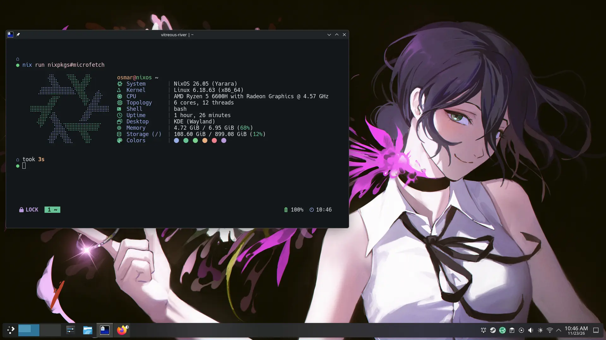
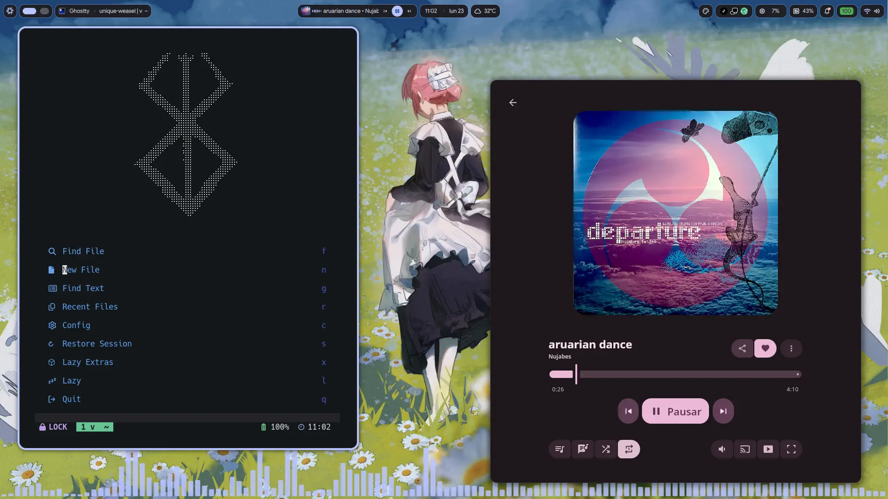

_Another dendritic Nix configuration, BTW :v_




# Usage

Clone the repo:

```bash
git clone https://github.com/osmarmora05/flake.git
```

## Options

### A. Local clone

1. In your NixOS configuration (`/etc/nixos/`), remove `configuration.nix`:

```bash
sudo rm /etc/nixos/configuration.nix
```

2. Move my configuration to your NixOS configuration:

```bash
cd flake && sudo mv ./* /etc/nixos/
```

3. Install the system:

```bash
cd /etc/nixos/ && sudo nixos-rebuild switch --upgrade-all --impure --flake .
```

### B. Build from remote

```bash
sudo nixos-rebuild switch --upgrade-all --impure --flake "github:osmarmora05/flake.git"
```

# Acknowledgments

- [voidarc's NixOS configuration](https://git.voidarc.co.uk/voidarc/nixos): A point of reference and a great [YouTuber](https://www.youtube.com/@Adumh00man).
